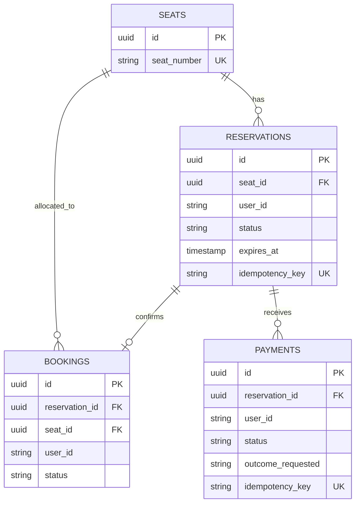

# The Last Seat

A REST API for a 500-seat concert booking system. It supports temporary reservations, simulated payments, cancellations, booking history, idempotency keys, automatic expiry, and concurrent requests.

## Stack

- Node.js 20 and Express
- PostgreSQL 16
- Docker Compose
- Jest and Supertest
- k6 for load testing

## Run with Docker

1. Install Docker Desktop and start it.
2. Copy `.env.example` to `.env` if you want to run the API outside Docker. Compose has its own database settings.
3. From this directory, run:

```bash
docker compose up --build
```

4. Check `http://localhost:3000/health`.
5. Open `http://localhost:3000/seats` to view the 500 seeded seats.

To stop the services, press Ctrl+C and run `docker compose down`. To remove the database volume and reset all data, run `docker compose down -v`.

The schema and 500 seats are loaded automatically on the first database start. If the database volume already exists and you change `schema.sql`, remove the volume before starting again.

## Run locally without Docker

Install Node.js 20+ and PostgreSQL 16+. Create a database named `lastseat`, then run the schema:

```bash
psql -U postgres -d lastseat -f schema.sql
```

Copy `.env.example` to `.env`, install dependencies, and start the API:

```bash
npm install
npm start
```

For development with automatic restarts, run `npm run dev`.

## API overview

All request bodies use JSON. Reservation and payment creation require an `Idempotency-Key` header. Use a new unique key for each distinct operation and reuse the same key when retrying the same request.

| Method | Path | Description |
|---|---|---|
| GET | `/health` | Health check |
| GET | `/seats` | List seats with available, reserved, or booked status |
| POST | `/reservations` | Create a temporary reservation |
| GET | `/reservations/:id` | Get reservation status |
| GET | `/reservations/user/:userId` | List a user's reservations |
| POST | `/reservations/:id/cancel` | Cancel a pending reservation |
| POST | `/payments` | Simulate payment success, failure, or delay |
| POST | `/bookings/confirm` | Confirm after successful payment |
| GET | `/bookings/history/:userId` | Get booking history |
| GET | `/bookings/:id` | Get booking details |
| POST | `/bookings/:id/cancel` | Cancel a confirmed booking |

### 1. List seats

```bash
curl http://localhost:3000/seats
```

### 2. Reserve a seat

Use the `id` returned by `/seats` for the desired seat.

```bash
curl -X POST http://localhost:3000/reservations \
  -H 'Content-Type: application/json' \
  -H 'Idempotency-Key: reserve-user-100-seat-1' \
  -d '{"seatId":"PASTE-SEAT-UUID-HERE","userId":"user-100"}'
```

The response contains the reservation UUID and `expires_at`. The default reservation duration is five minutes.

### 3. Simulate a successful payment

```bash
curl -X POST http://localhost:3000/payments \
  -H 'Content-Type: application/json' \
  -H 'Idempotency-Key: payment-reservation-UUID-1' \
  -d '{"reservationId":"PASTE-RESERVATION-UUID-HERE","userId":"user-100","outcome":"success"}'
```

A successful payment creates a confirmed booking atomically. The payment response includes both `payment` and `booking`.

### 4. Simulate a failed payment

```bash
curl -X POST http://localhost:3000/payments \
  -H 'Content-Type: application/json' \
  -H 'Idempotency-Key: payment-failure-001' \
  -d '{"reservationId":"PASTE-RESERVATION-UUID-HERE","userId":"user-100","outcome":"failure"}'
```

A failed payment cancels the pending reservation and releases the seat.

### 5. Simulate a delayed payment

```bash
curl -X POST http://localhost:3000/payments \
  -H 'Content-Type: application/json' \
  -H 'Idempotency-Key: payment-delay-001' \
  -d '{"reservationId":"PASTE-RESERVATION-UUID-HERE","userId":"user-100","outcome":"delayed","delayMs":8000}'
```

The payment request waits for the specified duration, then checks the reservation again. If the reservation expired or was cancelled during the delay, payment fails and no booking is created. `delayMs` is capped by `PAYMENT_MAX_DELAY_MS`.

### 6. Read a reservation and booking history

```bash
curl http://localhost:3000/reservations/PASTE-RESERVATION-UUID-HERE
curl http://localhost:3000/bookings/history/user-100
```

### 7. Cancel a booking

```bash
curl -X POST http://localhost:3000/bookings/PASTE-BOOKING-UUID-HERE/cancel \
  -H 'Content-Type: application/json' \
  -d '{"userId":"user-100"}'
```

The seat becomes available again after cancellation.

## Booking consistency and concurrency

1. A reservation transaction locks the selected seat using `SELECT ... FOR UPDATE` before checking active reservations and confirmed bookings.
2. Competing reservations for the same seat serialize on that seat row. After the first transaction commits, the next transaction rechecks the state and receives a conflict if the seat is unavailable.
3. A partial unique index permits at most one booking with `status = 'confirmed'` for each seat. This is a final database-level guard against double booking.
4. Reservation and payment idempotency keys are unique. Repeating the same operation with the same key returns the original record instead of creating a duplicate.
5. Payment processing locks the seat before locking its reservation, matching the lock order used by reservation and cancellation flows.
6. A successful payment checks the reservation's current state and expiry inside a transaction before creating the booking. A late payment cannot revive an expired reservation.
7. A worker expires pending reservations every five seconds. Availability queries also check `expires_at`, so an expired hold is not treated as active even before the worker updates its status.

This implementation simulates payment; it does not connect to a real payment gateway. Production payment integrations should use signed webhooks, payment-provider idempotency keys, reconciliation, authentication, rate limiting, and an outbox or queue for reliable asynchronous work.

## ER diagram



## Booking workflow

```mermaid
flowchart TD
    A[Choose seat] --> B[Lock seat row]
    B --> C{Seat available?}
    C -- No --> D[Return 409 conflict]
    C -- Yes --> E[Create temporary reservation]
    E --> F[Simulate payment]
    F --> G{Payment result and reservation still active?}
    G -- Success and active --> H[Create confirmed booking]
    G -- Failed --> I[Cancel reservation and release seat]
    G -- Expired or cancelled --> J[Reject late payment]
    H --> K[Seat remains booked]
    I --> L[Seat available again]
    J --> L
```



## Load testing

Install k6, start the API, and run:

```bash
k6 run load_test/k6-booking.js
```

The script targets the local API by default. To test a deployed or alternate URL:

```bash
k6 run -e BASE_URL=http://localhost:3000 load_test/k6-booking.js
```

The included script sends approximately 100 iterations per second for 30 seconds and records response-time and HTTP failure metrics. Run it against the environment you intend to report on and include the actual k6 output in your submission. Do not claim performance numbers until you have run the test.

For a focused race test, send many reservation requests for the same seat using different user IDs and different idempotency keys. Exactly one active reservation should be created; competing requests should receive HTTP 409. Confirm that only one confirmed booking can exist for the seat.

## Tests

```bash
npm install
npm test
```

The included Jest test checks the health endpoint. Database integration and concurrency tests should be run against a test database before final submission.

## Scaling notes

- Run multiple stateless API instances behind a reverse proxy or load balancer.
- Keep PostgreSQL as the source of truth for reservation and booking state.
- Add connection pooling and monitor pool saturation before increasing API instances.
- Add Redis only as a cache for read-heavy seat views; never rely on a cache alone to decide who owns a seat.
- Move delayed payments and expiry work to a durable queue when the workload requires it.
- Add authentication, authorization, request rate limits, structured logs, metrics, migrations, and backups before production deployment.

Run the focused concurrency test with Node.js 20+:

```bash
node load_test/concurrency-test.js
```

It selects one available seat and sends 100 simultaneous reservation attempts for that seat. The expected result is one created reservation and 99 conflicts. Set `REQUESTS=1000` to increase the request count. Run this test against a clean or otherwise available seat, and include the output as evidence in the final submission.
